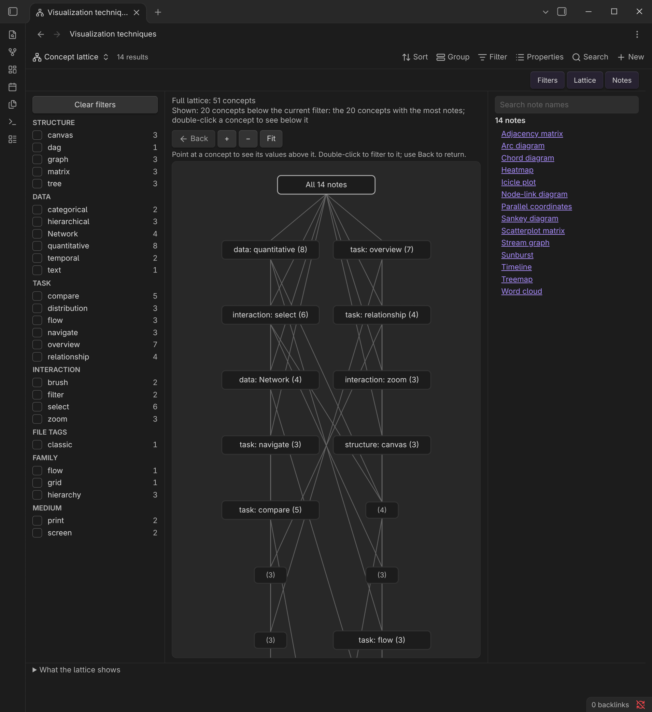

# [lattice-bases-view](osg://repo/local:06642ecd189313f8e47c74dc22023513c63e8c39)

Lattice Bases View is an Obsidian plugin. It adds the layout "Concept lattice" to Obsidian Bases.



## Why

Some notes do not fit in categories. A note about a person, a tool or an idea belongs to many groups at the same time. A folder or a class makes you select one group, and the other groups are lost.

This plugin uses attributes, not categories. You give each note the values that apply: tags, properties, links. You do not decide where the note belongs. The plugin computes the groups from the values that the notes share.

The result is a concept lattice (Formal Concept Analysis). Each concept is a set of notes and the set of values that all these notes share. You explore the lattice from the general concepts to the specific concepts. You find groups that you did not plan. It is also more fun than a folder tree.

## Requirements

- Obsidian 1.10.0 or later (`minAppVersion` in `manifest.json`).
- The core plugin Bases must be enabled. If Bases is not enabled, the plugin shows a notice and does not add the layout.

## Installation

### From a release

1. Download `main.js`, `manifest.json` and `styles.css` from a GitHub release.
2. Put the three files in `<vault>/.obsidian/plugins/lattice-bases-view/`.
3. In Obsidian, open Settings → Community plugins.
4. Enable "Lattice Bases View".

### From the source

1. Run `pnpm install`.
2. Run `pnpm build`. This command makes `main.js`.
3. Run `pnpm install:vault <vault path>`. The script copies `main.js`, `manifest.json` and `styles.css` to `<vault>/.obsidian/plugins/lattice-bases-view/`. Without a path, the script uses `test-vault`.
4. In Obsidian, open Settings → Community plugins.
5. Enable "Lattice Bases View".

## Quick start

1. Open a base.
2. Add a view.
3. Select the layout "Concept lattice".
4. Open the Properties menu of the view.
5. Select the properties to compare, for example `file.tags`.

The view uses only the notes that the filters and formulas of the base give.

## Facets

A facet is a property that you select in the Properties menu of the view. This is the menu that sets the columns of the Table layout. The facets have the order of the menu. The view shows each facet with the display name of the property in the base.

You can select these properties:

- Note properties, for example `structure`, `data`, `task` and `interaction` in the sample vault.
- File properties: `file.folder` (the folder of the note), `file.tags` (the tags) and `file.links` (the links in the note).
- Formulas of the base.

The plugin ignores `file.name`, `file.basename`, `file.path` and `file.file`. These properties give one value for each note, so no two notes share a value.

When no usable property is selected, the view shows a message that tells you to select properties. When you change the selected properties, the view draws the lattice again. The filter keeps only the values of the properties that are still selected.

Two selected properties can have the same name without the type prefix, for example `note.score` and `formula.score`. Then the view uses the first property and shows a warning.

In the `.base` file, the selected properties are the key `order` of the view.

### Tags

A flat tag such as `#draft` is a value of the tags facet.

A nested tag gives a facet of its own. The last segment of the tag is the value. The segments before it are the parent path, and each parent path is one facet. The name of the facet is the last segment of the parent path.

| Tag | Facet | Value |
| --- | --- | --- |
| `#draft` | tags | `draft` |
| `#viz/family/hierarchy` | `family` | `hierarchy` |
| `#pimo/language/python` | `language` | `python` |

- The parent tags (`#pimo`, `#pimo/language`) do not give values.
- When two facets have the same name, the facet from tags shows its path (`#pimo/language`).
- A facet from tags and a property with the same name stay two facets.
- When no note has a flat tag, the view does not show the tags facet.

## View options

| Option | Default | Range | Function |
| --- | --- | --- | --- |
| Concept budget (full lattice) | 5000 | 500 to 20000, step 500 | The maximum number of concepts that the plugin computes for the full lattice. |
| Concepts in the diagram | 20 | 10 to 150, step 5 | The maximum number of concepts in the diagram. |

An earlier version had a view option for facets (key `facets`). The view uses a stored `facets` list only when no usable property is selected.

## Parts of the view

The view has three panels, from left to right: the filters, the diagram and the notes column.

### Panel toggles and column widths

- The buttons "Filters", "Lattice" and "Notes" at the top right hide or show each panel. A pressed button means that the panel shows.
- One panel always stays visible. The button of the last visible panel is disabled.
- A hidden panel keeps its state: the filter, the focused concept, the search text and the scroll position.
- The plugin does not draw the diagram while the diagram is hidden.
- Drag the handle at the border of the filters or of the notes column to change the width of that column. The default widths are 15rem (filters) and 17rem (notes).
- A side column is 10rem wide at least. The diagram keeps 12rem at least.
- The handles take the keyboard focus. ArrowLeft and ArrowRight move a handle by 16 px.
- Double-click a handle to restore the default width of its column.
- When the diagram is hidden, the notes column gets the remaining width. When the notes column is hidden too, the filters get the full width.

The plugin stores the panel flags and the column widths for each vault on the device. It uses `App.saveLocalStorage` with the keys `lattice-bases-view-panels` and `lattice-bases-view-column-widths`. It does not store them in the `.base` file.

### Filters

The filters panel has one group of check boxes for each facet.

- Each value shows the number of matching notes.
- Selected values combine with AND.
- A value that all matching notes share has the mark "shared by all matching notes".
- A value that no matching note has is disabled.
- "Clear filters" removes the selected values, the search text and the focus.

### Diagram

The diagram shows the concepts below the current filter. Each edge goes down from a concept to a more specific concept.

A node shows the values that it adds to the concepts above it. It also shows its number of notes in parentheses, for example `interaction: select (6)`. A node that adds no value is small and shows only its number of notes, for example `(3)`.

When you point at a node, the diagram marks the node, all concepts above it and the edges between them. The values of the marked concepts together are the values of the node. The focused concept stays marked while the pointer is not on a different node.

| Action | Result |
| --- | --- |
| Point at a node, or move the keyboard focus to it | Marks the node and the concepts above it. Marks the notes of the node in the notes column. |
| Click a node, or press Enter or Space on it | Focuses the concept. |
| Arrow keys | Move the focus to a neighbor node. |
| Escape, or a click on the diagram background | Removes the focus. |
| Double-click a node, or press Shift+Enter on it | Filters to the concept. |
| "Back", or a double-click on the top concept | Goes back to the filter before. This works for more than one level. |
| Drag | Moves the diagram. |
| Mouse wheel | Scrolls the diagram up and down. Shift+wheel scrolls left and right. |
| Ctrl+wheel, a pinch on a trackpad, or `+` and `−` | Zooms. |
| "Fit" | Shows the top of the diagram, centered, at a scale from 0.7 to 1. |

- "Back" is disabled when there is no filter before. A change of a check box and "Clear filters" remove the previous filters.
- A change of the filter, the focus or the search does not move the diagram.
- The width of the diagram column limits the number of nodes in each layer. The diagram fits the width at scale 1 and grows down.
- A narrow column gives more layers with fewer nodes. A concept is not always in the layer directly below its upper neighbors, and an edge can pass over layers.
- The node width follows the longest label in the diagram (72 to 168 px).
- When the width does not fit at scale 0.7, "Fit" puts the top concept at the top center. Drag to see the other concepts.

### Notes column

The notes column shows, from top to bottom: the search field "Search note names", the count line and the list of notes.

- The list has the notes of the current filter, one on each line, in the order of Bases.
- The search filters the list by name. It does not change the lattice.
- Click a note name to open the note. Use Ctrl or Cmd to open it in a new tab.
- A long name is cut. The tooltip shows the full name.
- When the notes column is wider than 30rem, the list has several columns of 16rem.

When a concept is focused, its notes move to the top of the list and have an accent bar. The other notes stay in the list and are faded. The link "Filter to these K" sets the filter to the focused concept. When the concept is the current filter, the column shows the line "K of these are in the focused concept".

### Narrow layout

Below 700 px of width, the visible panels stack in this order: filters, diagram, notes. The view scrolls. The handles are hidden and the stored widths have no effect. The panel toggles work as in the wide layout.

The view does not show the properties of a single note. Use the Table layout of Bases for this.

## How to read the lattice

- The lattice shows recorded property values only.
- A missing value means "not annotated". It does not mean "false".
- When all matching notes share a value, this is a fact about these records. It is not a rule about the domain.
- The full lattice is the set of all concepts of the data. The status line "Full lattice" shows its size.
- The diagram shows only a part of the full lattice: the concepts below the current filter, at most "Concepts in the diagram".
- When the part is smaller than the concepts below the filter, the diagram shows the concepts with the most notes. Double-click a concept to see the concepts below it.
- The computation of the full lattice stops at the concept budget. Then the status line shows "more than N concepts (budget reached)".

## Sample vault

`test-vault/` has 14 notes about visualization techniques in `Techniques/`. The notes have the list properties `structure`, `data`, `task` and `interaction`. Five notes have nested tags with the parent paths `viz/family` and `viz/medium`. One note has the flat tag `classic`. Some notes do not have values for all facets.

`Visualization techniques.base` shows the notes of `Techniques/` with the layout "Concept lattice" and as a table. The selected properties are `structure`, `data`, `task`, `interaction` and `file.tags`. `Not a technique.md` is not in `Techniques/`, so the filter of the base excludes it.

## Limitations

- The plugin does not save the filter, the previous filters, the focus and the search in the `.base` file. They are lost when the view closes.
- Value comparison ignores case. `Tree` and `tree` are one value. The label is the first spelling that occurs.
- The plugin compares links by their display text. When a link has no display text, the plugin uses its target.
- An attribute id is `<facet>:<value>`. When a facet key contains `:`, two different values can get the same id.
- The diagram shows at most "Concepts in the diagram" concepts (`maxNodes`, default 20).
- The plugin does not show implications.
- The computation runs on the UI thread in time slices, not in a worker. `buildLattice` gives control to the event loop only between whole concepts. On a base with thousands of notes and hundreds of values, one step can block the UI.
- The plugin computes the diagram part on the UI thread for each filter change.
- The behavior in Obsidian is tested by hand. The automated tests cover the FCA core, the Bases adapter with a mock of `obsidian`, and the view modules that have no DOM code.
- The detection of error values from Bases is not verified against the Obsidian runtime.

## Development

```sh
pnpm install
pnpm verify   # tsc --noEmit, vitest run, production build of main.js
pnpm build    # production build of main.js only
pnpm dev      # build in watch mode
```

`pnpm verify` runs 12 test files with 156 tests. `AGENTS.md` describes the code layout, the rules and the manual test in `test-vault`.

The workflow `.github/workflows/release.yml` makes a GitHub release when you push a tag. The tag must be the version in `manifest.json`, for example `0.1.0`, without `v`.

## How it was made

An AI model wrote the code of this plugin: Claude Opus (Anthropic), from the prompt in [`prompt.md`](prompt.md). Cristian Vasquez wrote the prompt and directed the later changes, which AI coding agents also made. The prompt uses the first name of the plugin, Concept Atlas.

## License

MIT. See `LICENSE`.
